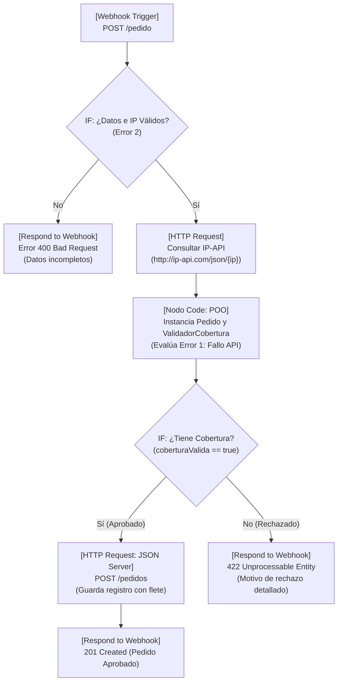

# DOCUMENTO DE LÓGICA DE NEGOCIO: ESCENARIO 2
## Sistema Automatizado de Pedidos con Verificación Geográfica de Cobertura
**Curso:** Laboratorio Integrador POO + Automatización con n8n  
**Modalidad:** Individual  
**Autor:** Estudiante  
**Fecha:** Octubre 2026  

---

## 1. El Problema de Negocio y Beneficios de la Solución

### 1.1 Contexto del Problema
En el comercio electrónico moderno, uno de los desafíos logísticos más críticos radica en la dispersión geográfica de los compradores. Muchas plataformas reciben órdenes sin antes validar si la ubicación física del cliente cuenta con rutas de entrega habilitadas. Esto provoca:
- Cobros indebidos de pedidos que no pueden ser despachados.
- Quejas de clientes y sobrecarga en el departamento de servicio al cliente para tramitar reembolsos.
- Pérdida de dinero por aplicar tarifas de envío fijas que no cubren los costos reales de transporte según el volumen o destino.

### 1.2 Justificación de la Solución Integrada (POO + n8n)
La solución desarrollada implementa un pipeline automatizado y reactivo en **n8n**, respaldado por la solidez y modularidad de la **Programación Orientada a Objetos (POO)** en JavaScript:
1. **Verificación en Tiempo Real:** Al recibir la orden de compra mediante un Webhook, se captura la dirección IP del cliente y se geolocaliza a través de un servicio externo (`IP-API`).
2. **Filtrado y Cálculo Dinámico:** Antes de persistir cualquier dato, el nodo Code ejecuta la lógica de negocio modelada en clases (`Pedido` y `ValidadorCobertura`) para verificar si el país está autorizado y calcular el flete exacto.
3. **Persistencia Condicional:** Solo las órdenes con viabilidad de entrega confirmada se guardan en el repositorio central de datos (**JSON Server**); las órdenes no viables se rechazan automáticamente notificando el motivo explícito.

---

## 2. Diseño del Workflow y Recorrido de los Datos

El workflow no es lineal; implementa bifurcaciones lógicas reales para la gestión de errores de entrada, fallos de conectividad y decisiones de negocio.



### Detalle de Nodos del Workflow:
1. **Webhook Trigger:** Expone el endpoint HTTP `POST /pedido` para recibir el payload JSON del cliente (`id`, `cliente`, `ipCliente`, `producto`, `cantidad`).
2. **IF - Validación Inicial de Entrada:** Filtra peticiones maliciosas o incompletas (comprueba formato IPv4 y campos requeridos).
3. **HTTP Request (IP-API):** Consume el servicio REST de geolocalización `http://ip-api.com/json/{{ $json.body.ip }}` con tiempo límite (timeout) y opción `continueOnFail: true` para resiliencia.
4. **Nodo Code (Lógica POO):** Ejecuta la lógica compartida de `Pedido` y `ValidadorCobertura`, aislando el cálculo logístico del resto del flujo.
5. **IF - Decisión de Cobertura:** Separa las órdenes aprobadas de las rechazadas según la lista blanca.
6. **HTTP Request (JSON Server):** Registra el pedido en `http://localhost:3000/pedidos` con su estado, costo de envío y país confirmado.
7. **Respond to Webhook:** Devuelve respuestas HTTP consistentes (201 para aprobados, 400 para datos inválidos y 422 para fuera de zona).

---

## 3. Reglas de Negocio Implementadas

Se diseñaron e implementaron **cinco (5) reglas de negocio** estrictas, observables tanto en el archivo `main.js` como en el nodo Code de `n8n`:

1. **Regla de Cobertura Territorial Estricta:**  
   Solo se aceptan pedidos cuyo país detectado pertenezca a la lista blanca oficial (por defecto: `Costa Rica`). Cualquier otro país o consulta no resuelta deriva en un rechazo inmediato.
2. **Tarifa Base Regionalizada:**  
   Cada territorio admitido posee una tarifa base de transporte (ej. Costa Rica: $5.00 USD) para amortizar el costo de despacho local.
3. **Recargo Logístico por Volumen/Cantidad:**  
   Para evitar que pedidos voluminosos generen pérdidas operativas, se añade un recargo incremental de $1.50 USD por cada artículo solicitado en la orden.  
   $$\text{Costo Envío} = \text{Tarifa Base} + (\text{Cantidad} \times 1.50)$$
4. **Estados y Trazabilidad Obligatoria:**  
   Todo pedido debe transitar por un ciclo de vida auditable. Inicia en estado `Pendiente` y solo puede finalizar en `Aprobado` (con país confirmado y costo de envío) o `Rechazado` (con motivo explícito y costo de envío en cero).
5. **Rechazo Explícito y No Persistente:**  
   Los pedidos rechazados no contaminan la colección principal de pedidos por despachar en JSON Server; en su lugar, se devuelve una notificación inmediata al cliente con el código HTTP 422 y la causa detallada.

---

## 4. Manejo de Errores y Situaciones Inesperadas

El sistema implementa defensas proactivas contra al menos dos contingencias críticas:

### Error 1: Falla o indisponibilidad del servicio externo (IP-API)
- **Escenario:** La API pública de IP-API sufre una caída de red, alcanza su límite de cuota por minuto, o devuelve `{ status: "fail" }`.
- **Comportamiento en el sistema:** El nodo HTTP tiene configurado `continueOnFail: true` para no interrumpir abruptamente el pipeline. El nodo Code inspecciona la respuesta en un bloque `try/catch`. Si el objeto contiene errores o el status no es `"success"`, se genera una excepción controlada de tipo `ERROR_API_EXTERNA`, marcando el pedido como `Rechazado` con el mensaje: *"Falla al contactar servicio de geolocalización"*.

### Error 2: Carga de datos incompleta o formato inválido en la solicitud
- **Escenario:** El cliente omite el ID, la IP, el producto o envía una cantidad menor o igual a cero.
- **Comportamiento en el sistema:** El nodo IF previo y el constructor de la clase `Pedido` validan rigurosamente los tipos de datos. Si un campo crítico falta, se lanza una excepción `ERROR_DATOS_CLIENTE` y el workflow retorna una respuesta HTTP 400 (Bad Request), impidiendo llamadas innecesarias a la API externa y ahorrando consumo de cuota.

---

## 5. Conexión entre la POO (main.js) y el Nodo Code de n8n

### 5.1 Principio de Lógica Única
Para evitar discrepancias entre el entorno de desarrollo y producción, **la lógica que rige las clases de `main.js` es idéntica a la ejecutada en el nodo Code de n8n**. No existen reglas dispersas en expresiones visuales ni fórmulas fragmentadas.

### 5.2 Estructura de Clases
- **Clase `Pedido`:** Encapsula la identidad y estado del requerimiento de compra. Aplica encapsulamiento y validaciones defensivas en su constructor.
- **Clase `ValidadorCobertura`:** Encapsula las políticas logísticas, la lista blanca de países y el algoritmo de cálculo de fletes.

### 5.3 Adaptación al Runtime de n8n
Dentro del nodo Code, se leen los datos utilizando la API nativa de n8n:
```javascript
const itemsEntrada = $input.all();
```
Por cada elemento recibido:
1. Se extrae el cuerpo del webhook y la respuesta del nodo IP-API.
2. Se instancia la clase `Pedido` con validación de excepciones.
3. Se invoca a `ValidadorCobertura.verificarPais()` y `calcularEnvio()`.
4. Se formatea la salida como un objeto JSON nativo (`return [{ json: { ... } }];`) apto para ser consumido por el nodo siguiente de JSON Server.

---

## 6. Decisiones Técnicas Relevantes y Conclusiones

1. **JavaScript ES6+ Nativo:** Se optó por clases nativas de ECMAScript sin dependencias externas pesadas, permitiendo que `main.js` se ejecute directamente en Node.js mediante `node main.js`.
2. **Respuesta Asíncrona Controlada:** El Webhook usa el modo `responseNode` (Respond to Webhook), lo que permite que el cliente reciba la respuesta final procesada por n8n (incluyendo el código de estado HTTP adecuado) en lugar de una confirmación genérica inmediata.
3. **Conclusión:** La integración de POO con plataformas de automatización iPaaS como n8n demuestra que la lógica de negocio compleja debe mantenerse estructurada y modular. El uso de clases facilita la realización de pruebas unitarias locales previas y garantiza que los flujos de automatización sean mantenibles, legibles y auditables.
